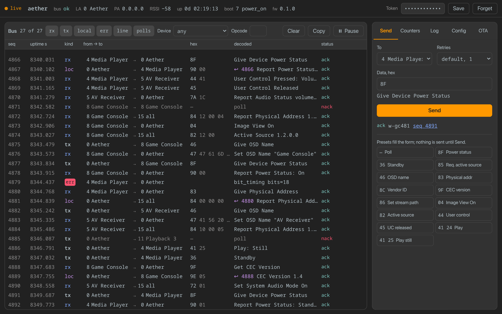
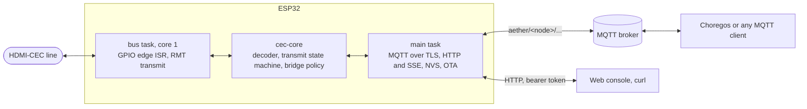

# aether-cec

**An HDMI-CEC bridge that reports what actually happened on the bus.** Rust
firmware for an ESP32 that publishes every CEC frame to MQTT with its ACK bit
and a microsecond timestamp, sends frames with spec-conformant retransmission,
and tells the host how each send ended.

[](https://github.com/yasen-pavlov/aether-cec/actions/workflows/ci.yml)
[](https://github.com/yasen-pavlov/aether-cec/releases)
[](https://sonarcloud.io/summary/new_code?id=yasen-pavlov_aether-cec)
[](https://sonarcloud.io/summary/new_code?id=yasen-pavlov_aether-cec)
[](LICENSE)



## Why

A home-theater controller that drives CEC needs to know three things a typical
bridge does not tell it: which request an acknowledgement belongs to, why a send
failed, and what else was on the wire at that moment. Two days of traces from a
Tasmota-based bridge ([`docs/protocol.md` §0](docs/protocol.md)) showed what is
missing:

- send results carry no request id, so a burst of results gets attributed to
  the wrong sends;
- one `Ack:false` covers NACK, arbitration loss, line error and a busy bus;
- the receiver is blind while a transmission is pending;
- nothing is retransmitted, and there is no signal-free-time handling.

aether is a bridge built around those gaps. It is the native bridge for
[Choregos](https://github.com/yasen-pavlov/choregos) (`bridge.kind = "aether"`),
and the protocol is plain JSON over MQTT, so anything that can publish and
subscribe can use it.

## What it does

- **One ordered bus stream.** Every frame on the bus (received, host-sent,
  locally answered, failed) is one event on `aether/<node>/bus` with a per-boot
  sequence number, the device-side timestamp of its start bit and the observed
  ACK bit. Polls and frames from unregistered initiators are included.
- **Correlated, typed send outcomes.** A send request carries a host id; the
  outcome echoes it with `ack`, `nack`, `arb_lost`, `line_error`, `busy` or
  `rejected`, and the number of attempts it took.
- **Spec-conformant transmit.** Signal-free times for new, repeated and retried
  frames, retransmission after NACK (never for polls unless asked, so a NACK
  stays evidence of absence), arbitration loss and line-error recovery, and
  reception that continues while a send waits for the bus.
- **Keeps answering when the host is down.** Physical address, vendor id, OSD
  name, CEC version and power status are answered on the device, from a
  configurable reply set. It never answers `<Request Active Source>` or an
  unregistered initiator.
- **Operable.** Retained status with last will, periodic telemetry (bus error
  counters, heap, RSSI, queue depth), remote configuration, push OTA with
  SHA-256 check and bootloader rollback, and crash summaries recovered from a
  flash core dump on the next boot.
- **Web console on the device.** A single embedded page: live bus monitor with
  decoded frames, send panel, counters, log tail, configuration form and OTA
  upload. No build step, no external assets.
- **Secrets stay on the serial port.** Wi-Fi and MQTT credentials and the HTTP
  token are provisioned over USB and stored in NVS; they are never readable
  over MQTT or HTTP and never logged.

## How it fits together



The CEC logic is pure and runs on the host: time is an injected microsecond
counter, hardware is a thin executor that feeds edges in and carries actions
out. That is what makes the timing-sensitive parts testable without a board.

| Path | What it is |
|---|---|
| [`crates/cec-core`](crates/cec-core) | `no_std`, no allocation, no `unsafe`: edge-level decoder, block-level transmit state machine, bridge policy (ACK set, local replies, logical-address allocation) |
| [`crates/aether-proto`](crates/aether-proto) | serde types for every protocol payload; `no_std` by default, `std` feature for hosts |
| [`crates/aether-logic`](crates/aether-logic) | host-tested firmware logic: configuration, console parsing, command plans, HTTP policy, bounded MQTT ingress |
| [`firmware/`](firmware) | the esp-idf application: GPIO/RMT executor, Wi-Fi, MQTT, HTTP, NVS, OTA, serial console, embedded web console |
| [`tests/fixtures`](tests/fixtures) | frames distilled from real bus traces, used by the host tests |

## Hardware

An ESP32-WROOM-32 DevKit (4 MB flash, no PSRAM) and an HDMI breakout:

| HDMI pin | Signal | ESP32 |
|---|---|---|
| 13 | CEC | GPIO 4 (default, `cfg.gpio.cec`) |
| 17 | DDC/CEC ground | GND |

The pin is driven open-drain with no internal pull resistor; the bus pull-up
comes from the HDMI device the breakout is plugged into. Nothing else is
connected: no HPD, no DDC, no 5 V.

## Quick start

Install the ESP Rust toolchain with [`espup`](https://github.com/esp-rs/espup),
plus `ldproxy` and `espflash`, then build and flash over USB:

```sh
. "$HOME/.espup-export.sh"
cd firmware
cargo build --release
bootloader=(target/xtensa-esp32-espidf/release/build/esp-idf-sys-*/out/build/bootloader/bootloader.bin)
espflash flash --flash-size 4mb --partition-table partitions.csv \
  --bootloader "${bootloader[0]}" --monitor target/xtensa-esp32-espidf/release/aether
```

Provision it on the serial console (115200 baud, no echo), then reboot:

```text
set wifi "example-ssid" "example password"
set mqtt broker.example.org 8883 example-user "example password" tls
set node aether
show token
reboot
```

Watch the bus and send a frame:

```sh
mosquitto_sub -v -t 'aether/aether/#'
mosquitto_pub -t 'aether/aether/tx' -m '{"id":"m-1","to":5,"data":"8F"}'
```

```json
{"ev":"rx","seq":814,"t_us":48400017,"from":0,"to":5,"data":"8F","ack":true}
{"ev":"tx","seq":815,"t_us":48512000,"id":"m-1","origin":"host","from":0,"to":5,"data":"8F","status":"ack","attempts":1}
{"ev":"rx","seq":816,"t_us":48590900,"from":5,"to":0,"data":"9000","ack":true}
```

The web console is at `http://<bridge>/`; it asks once for the token printed by
`show token`. The first flash over other firmware, the partition layout, TLS
behaviour and reset semantics are in [`docs/firmware.md`](docs/firmware.md).
Prebuilt images are attached to each
[release](https://github.com/yasen-pavlov/aether-cec/releases).

## Interfaces

| Topic | Direction | Payload |
|---|---|---|
| `aether/<node>/status` | bridge → host, retained, last will | online flag, firmware, boot counter, reset reason, logical and physical address, bus health |
| `aether/<node>/bus` | bridge → host | `rx`, `tx`, `err` and `line` events in one ordered stream |
| `aether/<node>/tx` | host → bridge | send request `{"id","to","data"}` |
| `aether/<node>/telemetry` | bridge → host | periodic counters |
| `aether/<node>/cfg` | bridge → host, retained | effective configuration |
| `aether/<node>/cmd/<verb>` | host → bridge | `cfg`, `state`, `ping`, `restart`, `reset`; outcome on `cmd/result` |
| `aether/<node>/ota` | bridge → host | OTA progress and verdict |

The HTTP API on port 80 takes the same JSON bodies (`/api/status`, `/api/cfg`,
`/api/tx`, `/api/cmd/<verb>`, `/api/events` as server-sent events, `/api/ota`).
It is plaintext and meant for a trusted LAN segment; every route except `/` and
`/healthz` needs the bearer token.

## Status

Alpha, in daily use. The firmware has been the CEC bridge on a living-room bus
with five other devices since 2026-11-01. `v0.1.0` was tagged after one boot had
run 10.9 days without a reset: 32,050 frames received with 0.47 % receive errors
(the Tasmota build it replaced lost about 3 %), more than half of them caused by
another device's wedged CEC receiver. Verified on hardware: promiscuous receive
with ACK bits, follower ACK, local identity replies, directed and broadcast
sends, OTA upgrade and bootloader rollback, crash capture.

Known limits:

- ESP32 (Xtensa, WROOM-32) only.
- No HPD input and no EDID read; the physical address is configured, not discovered.
- OTA is push over HTTP only; the MQTT `log` topic is not implemented.
- One live web console at a time on a 4 MB module (each stream costs about 27 KB of heap).
- Certificate validity dates are not checked (the device has no wall clock); chains and hostnames are.

## Documentation

| Document | Contents |
|---|---|
| [`docs/protocol.md`](docs/protocol.md) | the MQTT contract, with the trace evidence behind each decision |
| [`docs/openapi.yaml`](docs/openapi.yaml) | the HTTP API as OpenAPI 3.1 |
| [`docs/firmware.md`](docs/firmware.md) | build, flash, partitions, provisioning, TLS, resets, crash diagnostics |
| [`docs/http-api.md`](docs/http-api.md) | token handling, web console, `curl` examples, push OTA |
| [`docs/bench.md`](docs/bench.md) | checks to run with a board on a real bus and a logic analyzer |
| [`docs/design.md`](docs/design.md) | the Rust API of the core crates and the firmware executor layout |
| [`docs/decisions.md`](docs/decisions.md) | dated decisions and bench findings |

## Development

The workspace builds and tests on a stable host toolchain; only `firmware/`
needs the Xtensa toolchain.

```sh
cargo test --all-features
cargo clippy --all-targets --all-features -- -D warnings
cargo fmt --check
cargo build -p aether-cec-core -p aether-cec-proto --target thumbv7em-none-eabi   # no_std check
```

Changes land through pull requests against a protected `main`: signed commits,
linear history, and green CI (host tests with coverage, the declared minimum
Rust version, a full firmware build with image-size and sdkconfig checks, the
OpenAPI contract and documentation links, SonarQube Cloud). A signed `v*` tag
builds and publishes the firmware images. Conventions for contributors and
coding agents are in [`AGENTS.md`](AGENTS.md).

## License

[MIT](LICENSE)
